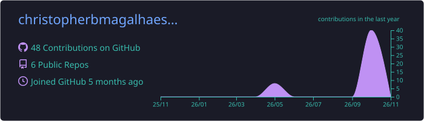
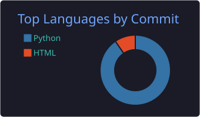
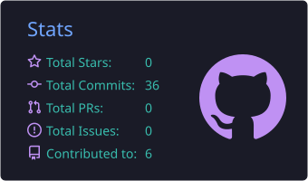
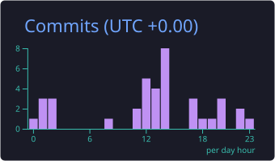

# Olá! Eu sou Christopher 👋

Sou estudante de **Sistemas de Informação** e desenvolvedor em formação, com foco em **desenvolvimento Full Stack**, especialmente Back-end, e criação de soluções web.

Tenho experiência prática em projetos utilizando **Python, JavaScript, C, HTML, CSS, SQL, MySQL e SQLite**, além de ferramentas e tecnologias como **Flask, Pandas, OpenPyXL, Git/GitHub, APIs, JSON e LocalStorage**.

Também venho explorando **Inteligência Artificial, agentes de IA, automação de processos e desenvolvimento seguro**, aplicando conhecimentos adquiridos em projetos e formações complementares.

Aqui no meu GitHub compartilho projetos acadêmicos, projetos desenvolvidos durante formações e experimentos que fazem parte da minha jornada de aprendizado e evolução na programação.

---

## 🌐 Onde me encontrar

  
  

---

## 🛠️ Tecnologias e Ferramentas

### Linguagens e Tecnologias Web

### Back-end, Banco de Dados e Manipulação de Dados

### Ferramentas e Automação

---

## 🤖 Inteligência Artificial

Conhecimentos desenvolvidos em formações e atividades práticas envolvendo ferramentas e conceitos de IA.

- 🧠 Engenharia de Prompts e Modelos de Linguagem (LLMs)
- 🔗 Agentes de IA e integração com ferramentas
- 📚 RAG (Retrieval-Augmented Generation)
- 🔌 MCP (Model Context Protocol) e engenharia de contexto
- ⚙️ Automação de processos com n8n
- 💬 Chatbots e fluxos conversacionais com Typebot
- 📊 Integração de ferramentas de IA com Google Sheets

---

## 🔐 Desenvolvimento Seguro

Conhecimentos introdutórios em segurança de aplicações e práticas de desenvolvimento seguro.

- 🛡️ Fundamentos de DevSecOps
- 🔍 Threat Modeling e análise de segurança
- 🔒 Segurança desde as etapas de design e desenvolvimento
- 🧩 Conceitos de proteção de aplicações e revisão de código

---

## 🧠 Conceitos & Conhecimentos

- 🧩 **POO** (Programação Orientada a Objetos) e Lógica de Programação
- ⚡ **CRUD**, APIs REST e Integração de Sistemas
- 🏗️ **Arquitetura Modular** e Estruturas de Dados
- 💾 **Modelagem de Banco de Dados** e Bancos Relacionais
- 📂 Manipulação de Arquivos e Planilhas com Python
- 🌐 JSON, LocalStorage e Persistência de Dados

---

## 📊 Minhas Estatísticas

<table align="center">
  <tr>
    <td colspan="2" align="center">
      
    </td>
  </tr>
  <tr>
    <td width="50%" align="center">
      
    </td>
    <td width="50%" align="center">
      
    </td>
  </tr>
  <tr>
    <td colspan="2" align="center">
      
    </td>
  </tr>
</table>

  

---

💡 *Estou sempre buscando aprender novas tecnologias, aprimorar minhas habilidades e transformar conhecimento em projetos práticos!*
